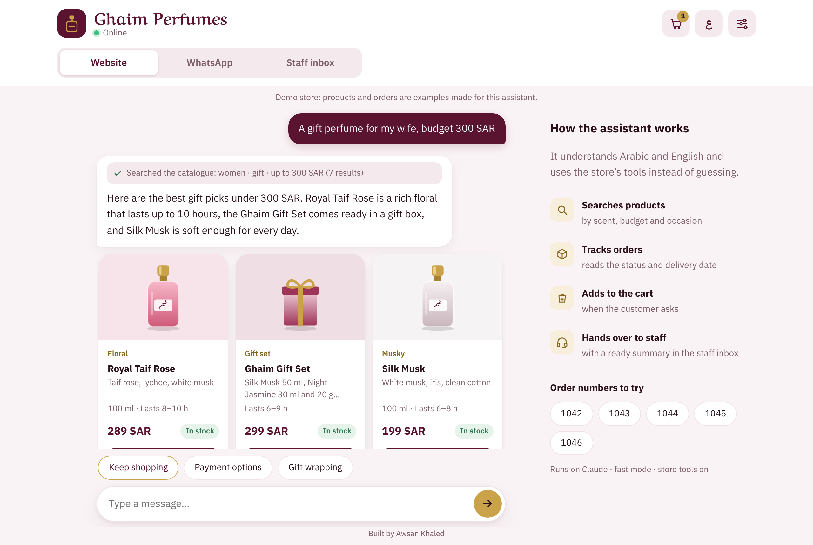
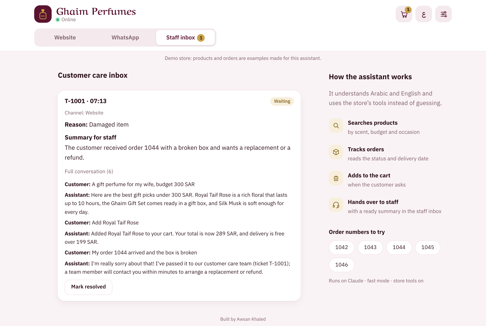
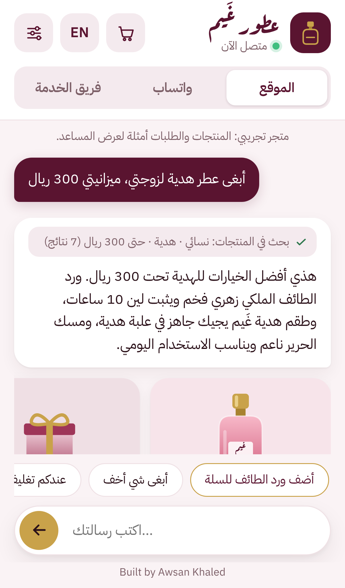
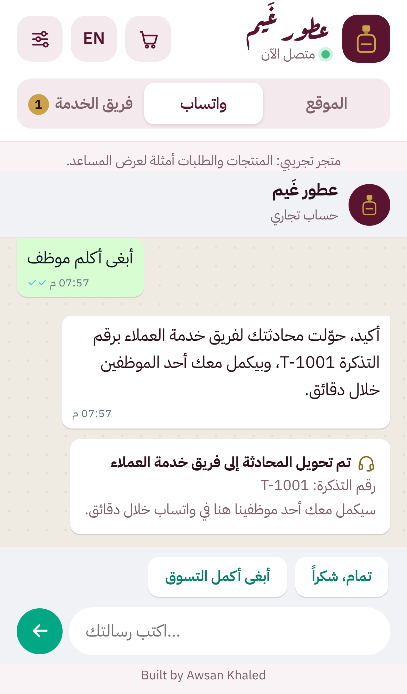

# Ghaim Perfumes · AI shopping assistant demo

**Live demo: [shop.awsankhaled.com](https://shop.awsankhaled.com)**

An Arabic-first shopping assistant for a sample perfume store in Saudi Arabia. Customers chat in Gulf Arabic, Modern Standard Arabic or English, and the assistant:

- **recommends perfumes** by taste, budget, occasion and who they are for, shown as product cards with an add-to-cart button;
- **tracks orders** (try 1042 to 1046), including numbers typed in Arabic-Indic digits;
- **adds products to the cart** when the customer asks;
- **hands the chat to a person** for complaints, refunds, damaged items or payment problems, with a ready summary in the staff inbox.

The same assistant runs in three tabs: the store **website**, a **WhatsApp preview** (shorter replies, WhatsApp look) and the **staff inbox** where handed-over chats arrive with a summary and the full conversation. The website and WhatsApp chats are independent, like two different customers: each has its own conversation, cart and quick replies, and each can wait for a reply while you use the other. Handovers from both land in the one staff inbox, marked with their channel. The page switches between Arabic (right to left) and English.

| Website chat (desktop) | Staff inbox |
| --- | --- |
|  |  |

| Website chat (phone) | WhatsApp preview (phone) |
| --- | --- |
|  |  |

<sub>Screenshots taken locally against the test mock (`tests/mock-anthropic.php`), so the replies are canned.</sub>

## How it works

1. **The page** (`index.html`, one file with inline CSS and JS) keeps the website chat and the WhatsApp chat separately in the browser, each with its own cart, plus the staff tickets. Only the settings (language, reply speed, steps on or off, WhatsApp number) are saved, in `localStorage`. For each message it posts that chat's last 16 turns with the channel, reply speed, that chat's cart and open tickets, and the next ticket id to `api/chat.php`. The browser never sends prompt text and cannot pick a model.
2. **`api/chat.php`** checks the Origin header and the request, counts the message against the limits, and builds the system prompt on the server in two blocks. The first one holds the instructions and store policies; it stays the same for every request, so it can be cached together with the four tools. The second holds what changes per request: the channel, today's date in Saudi time, the cart and the open tickets.
3. **The tool loop** calls the AI provider set in the private config with cURL: the Gemini API (`generateContent`, the default) or the Claude Messages API. Both get the same prompt, the same four tools and the same limits, and both return the same reply to the page. `search_products` and `get_order_status` are answered from the files in `data/`. Search results the customer has already seen (the `[[p01]]` markers in earlier replies) are marked and listed last. When nothing new fits, the same search also returns the nearest products just above the budget, so the assistant can say so honestly and offer another scent family or a higher budget without another model call. `add_to_cart` and `handoff_to_staff` are checked on the server (the product exists and is in stock; one handover per reply, using the ticket id the page sent) and come back to the page as actions. A message gets at most 5 model calls; the last allowed call has to answer in text.
4. **The reply** is `{text, actions, steps}`. While waiting, the page shows typing dots. It then shows the steps one by one (about 250 ms apart), applies the actions to the cart and the staff inbox, and renders the text with its product cards (`[[p01]]`) and quick replies (`[[chips: a | b]]`).

`api/health.php` answers `{"ok":true,"provider":"gemini"}` (or `"claude"`) when the private config is found, enabled and has a key for the selected provider. It never calls the AI provider. The page uses it for the green status dot, and for the privacy line under the chat box when the provider is Gemini.

## Project structure

```
.
├── index.html              the whole front end: HTML, CSS and JS in one file
├── favicon.svg
├── assets/
│   ├── og-image.png        link preview image (Open Graph)
│   └── products/           product photos (600x400 WebP) and their credits
├── data/
│   ├── products.json       catalogue: products, scent families, audiences, occasions (public)
│   └── orders.json         sample orders, read only by the server (blocked from the web)
├── api/
│   ├── chat.php            POST: one assistant reply, with the tool loop
│   ├── health.php          GET: {"ok":true} when the server is configured
│   └── lib/                server code (blocked from the web)
│       ├── bootstrap.php     error handling, JSON responses, small helpers
│       ├── config.php        finds the private config, prepares the storage folder
│       ├── request.php       Origin check and request validation
│       ├── store.php         catalogue loading, search_products, get_order_status
│       ├── prompt.php        system prompt, store policies, the four tools
│       ├── gemini.php        Gemini API calls (generateContent) with cURL, retries, the tool loop
│       ├── claude.php        Claude Messages API calls with cURL, retries, the tool loop
│       └── limits.php        rate limits and the monthly usage log
├── config.example.php      template for the private config
├── tests/                  mock Gemini and Claude APIs, smoke test, browser check (blocked from the web)
├── docs/                   screenshots for this README
├── .htaccess               access rules for LiteSpeed and Apache
└── .gitignore
```

Plain PHP 8.1+ with the cURL extension. No SDK, no Composer, no build step.

## AI provider: Gemini or Claude

The assistant runs on **Google Gemini** by default. Claude is still built in, and one line in the private config switches between them:

```php
'provider' => 'gemini',   // or 'claude'
```

Only the selected provider's key is needed and checked. Everything else stays the same: the page, the prompt, the four tools, the 5-call tool loop, the limits and the security rules. The switch works from the next message on, with no deploy.

- **Gemini** reads `gemini_api_key`, `gemini_models` (`fast` and `smart`) and `gemini_base_url`.
- **Claude** reads `anthropic_api_key`, `workspace_id`, `models` (`fast` and `smart`) and `anthropic_base_url`.

A config written before the switch existed still loads. Without a `provider` line it uses Gemini, so add `gemini_api_key` to it, or add `'provider' => 'claude'` to keep running on Claude.

### A free Gemini API key

1. Open [Google AI Studio](https://aistudio.google.com/) and sign in with a Google account.
2. Choose **Get API key**, then **Create API key**. AI Studio creates a Google Cloud project for it if you have none.
3. Copy the key into `gemini_api_key` in the private config. Use a separate key for this demo, so you can limit or delete it on its own.

A key from a project without billing uses the **free tier**. Its limits (requests per minute and per day, tokens per minute) depend on the model and change from time to time; AI Studio shows the current limits and your usage for each project. When a limit is reached, visitors see "The service is busy" and the server passes on Google's retry time.

**Privacy:** on the free tier, Google may use prompts and replies to improve its products, and people may review them. So while the provider is Gemini, the page shows one line under the chat box, in Arabic or English: *This demo uses Google's Gemini API, so please don't share personal information.* See the [Gemini API terms](https://ai.google.dev/gemini-api/terms) for the details.

## Deploying on Hostinger

The site is plain files: Hostinger's Git deployment copies the `main` branch as it is into the subdomain's folder. The API key never goes into that folder.

1. **PHP version.** In hPanel open **Advanced → PHP Configuration** for the website and choose PHP 8.1 or newer (8.3 is fine). The cURL extension is on by default.
2. **Subdomain.** Create the `shop` subdomain (**Domains → Subdomains**). Hostinger puts its files in a folder inside `public_html`, for example `domains/awsankhaled.com/public_html/shop`. The folder must be empty for the first Git deployment.
3. **Git deployment.** In **Advanced → Git**, add the repository `https://github.com/Awsan01/ghaim-shopping-assistant.git`, branch `main`, and set the install path to the subdomain folder (`shop`). For a private repository, add the SSH key that hPanel shows there as a deploy key in GitHub (**Settings → Deploy keys**) and use the `git@github.com:` address. Press **Deploy**. To deploy on every push, copy the auto-deployment webhook URL from the same page into GitHub (**Settings → Webhooks**).
4. **Private config.** Open **Files → File Manager** and go to `domains/awsankhaled.com/`, the folder that contains `public_html`. Create a folder named `private`, and in it a file named `ghaim-config.php`. Paste the content of [`config.example.php`](config.example.php), then fill in:
   - `provider`: `gemini` (the default) or `claude`;
   - `gemini_api_key`: a key from [Google AI Studio](https://aistudio.google.com/) (see [A free Gemini API key](#a-free-gemini-api-key)), when the provider is Gemini;
   - `anthropic_api_key`: a key from the [Claude Console](https://platform.claude.com/), when the provider is Claude. Use a separate key for this demo, so you can limit or revoke it on its own;
   - `ip_salt`: any long random string (or leave it empty and one is generated).

   The final paths look like this:

   ```
   domains/awsankhaled.com/
   ├── private/
   │   ├── ghaim-config.php     ← your keys, outside the web root
   │   └── ghaim-storage/       ← created by the app: rate limits and usage logs
   └── public_html/
       └── shop/                ← this repository
   ```

   The app looks for `private/ghaim-config.php` in the folders above itself (up to 6 levels), skipping `public_html` and everything inside it. If hPanel gave the subdomain its own folder (`domains/shop.awsankhaled.com/public_html`), put `private/` next to that `public_html` instead. If your files live elsewhere, set the `GHAIM_CONFIG` environment variable to the config's full path.
5. **HTTPS.** Under **Security → SSL**, make sure the subdomain has a certificate and turn on **Force HTTPS**.
6. **Check it.**
   - `https://shop.awsankhaled.com/api/health.php` shows `{"ok":true,"provider":"gemini"}`;
   - `https://shop.awsankhaled.com/.git/config`, `/data/orders.json`, `/README.md` and `/api/lib/config.php` all answer 403;
   - the page shows a green dot next to the store name, the Gemini privacy line under the chat box, and a question gets a reply.
7. **Limits.** On the Gemini free tier there is nothing to pay; AI Studio shows the project's rate limits and usage. If you enable billing on the key's project, or use Claude, set a spend limit: a budget alert in Google Cloud Billing for Gemini, a monthly spend limit in the Claude Console for Claude. If a key is invalid, or Claude's credit or spend limit runs out, the demo shows "paused" instead of an error.

### Pausing the demo

Edit `private/ghaim-config.php` in the File Manager and set `'enabled' => false`. From the next request on, every API call answers 503 and visitors see "The demo is paused for now"; no AI provider is called. Set it back to `true` to resume. You can also lower the `limits` instead of pausing.

### Usage log

Each answered message adds one line to `private/ghaim-storage/usage-YYYY-MM.csv`:

```
time,provider,model,input_tokens,output_tokens,cache_write_tokens,cache_read_tokens,status
2026-11-19T22:45:19+03:00,claude,claude-haiku-5-5,280,120,1650,1650,ok
2026-11-28T18:02:41+03:00,gemini,gemini-3.1-flash-lite,1930,160,0,1650,ok
```

It holds the provider, token counts and a status (`ok`, `truncated`, `refused`, `busy`, `paused` or `error`), never message text or IP addresses. For Gemini, `input_tokens` are the prompt tokens not read from Google's cache, `output_tokens` include the thinking tokens, `cache_read_tokens` are the cached prompt tokens and `cache_write_tokens` is always 0 (Google's implicit caching has no write charge). A log started before the provider column existed gets the column the next time a line is added; its older lines are marked `claude`.

## Local development

```bash
cp config.example.php config.local.php
```

Put your API key in `config.local.php` (`gemini_api_key`, or `anthropic_api_key` with `'provider' => 'claude'`). It is ignored by git and read only by PHP's built-in server. Then start the server from the project folder:

```bash
php -S localhost:8000
```

Open http://localhost:8000. Rate limits and logs go to `./ghaim-storage` (also ignored by git).

To work on the page without an API key or spending tokens, run a test mock and point `config.local.php` at it with `'gemini_api_key' => 'local'` and `'gemini_base_url' => 'http://127.0.0.1:8090'`:

```bash
php -S 127.0.0.1:8090 tests/mock-gemini.php
```

For the Claude mock, use `'provider' => 'claude'`, `'anthropic_api_key' => 'local'` and `'anthropic_base_url' => 'http://127.0.0.1:8090'`:

```bash
php -S 127.0.0.1:8090 tests/mock-anthropic.php
```

### Tests

```bash
tests/smoke.sh
```

It runs the whole test twice, once against the Gemini mock (`tests/mock-gemini.php`) and once against the Claude mock (`tests/mock-anthropic.php`); `tests/smoke.sh gemini` or `tests/smoke.sh claude` runs one. Each run does `php -l` on every PHP file, starts the app and the mock with `php -S`, and checks, among others:

- a recommendation with product cards, the lookup of order 1042, the add-to-cart action, the handoff action with its ticket id;
- a request for another option: no product is offered twice, and when nothing new fits the reply says so;
- the 5-call tool loop (function calling off on the last call), retries on 529 and 5xx, and how API errors map to busy, paused and error;
- on Gemini: the key in the `x-goog-api-key` header and never in the URL, thought signatures sent back unchanged, one function response per call, the thinking setting per model (and the retry without it when the API rejects it), Google's retry time passed on as `Retry-After`, and safety blocks returned as refusals;
- invalid input → 400, too many messages → 429, wrong Origin → 403, missing config, `enabled => false`, an unknown provider or no key for the selected provider → 503;
- that the config is found above `public_html` with `open_basedir` set, that the usage log names the provider and has no message text, and that the key never reaches a response.

With Node and [Playwright](https://playwright.dev) installed it also runs `tests/browser-check.js`, which drives the page in headless Chromium. It checks for console errors, that the product photos load, a reply with product cards, the cart badge, the WhatsApp tab, that the website and WhatsApp chats (and their carts) stay separate, a ticket in the staff inbox, the language switch, the busy message with its retry button, the stop button and, on Gemini, the privacy line under the chat box.

## Editing the store

**Products: `data/products.json`.** The page and the server both read this file.

- `products`: one entry per product.
  - `id`: `p` plus two digits, like `p20`; the reply marker `[[p20]]` uses it.
  - `ar` and `en`: names; `notes_ar` and `notes_en`: scent notes.
  - `fam`: a key of `families`; `for`: `women`, `men` or `unisex`.
  - `sz`: `[100, "ml"]`, `[50, "g"]` or `null`; `price`: in SAR.
  - `hours`: how long it lasts, `[8, 10]`, or `null`.
  - `stock`: `0` shows "sold out", 5 or less shows "only N left".
  - `tags`: occasions, keys of `occasions`.
  - `img`: the card photo, for example `assets/products/p20.webp`. Use a 3:2 picture; 600x400 WebP keeps the page light. Without `img`, the card shows a drawn bottle instead.
- `families`: Arabic and English names, plus the two bottle colours (`c`) and bottle shape (`s`, 0 to 3) used for the drawn bottle.
- `who` and `occasions`: labels in both languages. Their keys are also the values the search tool offers the model.
- `sample_orders`: the order numbers shown as "Order numbers to try" on the page.

**Photos: `assets/products/`.** Real photographs under CC0 (public domain), found through Openverse, with no brand names or logos; Ghaim and its products are fictional. Sources are listed in [`assets/products/CREDITS.md`](assets/products/CREDITS.md); add a line there when you add a photo.

**Orders: `data/orders.json`.** One entry per order number, for example `"1042"`.

- `items`: `[product id, quantity]` pairs.
- `status`: `processing`, `shipped`, `out_for_delivery` or `delivered`.
- `placed`, `shipped`, `eta`, `delivered`: day offsets from today in Saudi time, so `-2` means two days ago and `2` means in two days. The dates never go stale.
- `city`, and an optional `note`.

**Policies and instructions: `api/lib/prompt.php`.** Shipping, payment, returns, gift wrapping and opening hours are in `GHAIM_POLICIES` at the top of the file. The rest of the assistant's instructions are in `ghaim_static_prompt()` just below.

After editing, run `tests/smoke.sh`: it also checks that the JSON is valid, that every order uses known products, that every product photo exists, and that oriental and oud perfumes are still on offer within 300 SAR (a common budget, and a common question).

## Models and costs

| Reply speed (Settings) | Gemini (default) | Claude |
| --- | --- | --- |
| Fast (default) | `gemini-3.1-flash-lite` | `claude-haiku-5-5` |
| Smarter, slower | `gemini-3.8-flash` | `claude-sonnet-5-5` |

The models are set in the private config (`gemini_models` and `models`). The browser only says `fast` or `smart`. Both Gemini models are listed as free of charge on the free tier on Google's [pricing page](https://ai.google.dev/gemini-api/docs/pricing); 3.8 Flash is the newest Flash model there.

**On the Gemini free tier the demo costs nothing.** What limits it are Google's free-tier rate limits, shown in AI Studio. When they are reached, visitors see "busy" until Google's retry time has passed. On a paid Gemini key, or on Claude, what drives the cost:

- **Calls per message.** Each message takes 1 to 5 model calls: a tool round (search, order lookup, cart, handover) adds a call. A typical recommendation takes two.
- **Reply size.** Thinking is kept as low as each model allows: on Gemini 3 models `thinkingLevel` is `minimal` where the model offers it (3.1 Flash-Lite) and `low` otherwise (3.8 Flash); Gemini 2.5 models get `thinkingBudget` 0, or 128 on 2.5 Pro; Claude uses low effort. Thinking counts toward `max_tokens` (`maxOutputTokens` on Gemini), so it is 4096 per call: room for the thinking plus the reply. Replies stay short because the instructions ask for 1 to 3 sentences, and only the tokens actually generated are billed.
- **Caching.** The tools and the fixed instructions (about 2,000 tokens) come first in every request. Claude caches them with prompt caching; Gemini caches repeated prompt beginnings by itself (implicit caching). Cached tokens cost a fraction of the input price.
- **Limits.** Per visitor IP: 30 messages per hour and 100 per day. Whole site: 500 messages per day. So the daily worst case is 500 messages × 5 calls.

Prices and free-tier limits change, so this README does not list them. See Google's [pricing page](https://ai.google.dev/gemini-api/docs/pricing) and the limits in AI Studio, or Anthropic's [pricing page](https://platform.claude.com/docs/en/about-claude/pricing), and multiply by the token counts in the usage log for real numbers. A budget alert or spend limit is the final safety net on any paid key.

## Security notes

- **The API keys stay on the server**, in a file outside `public_html`. They are never sent to the browser. The Gemini key goes in the `x-goog-api-key` header, never in a URL, so it cannot end up in access logs. Responses contain no raw API errors, no stack traces and no PHP warnings; details go to the server's error log.
- **`.htaccess`** turns off directory listings and blocks dotfiles (including `.git`), Markdown files, `config*.php`, `data/orders.json`, `api/lib/` and `tests/`. It uses mod_rewrite where available, with mod_alias and file-name rules as fallbacks, and `api/lib/` and `tests/` have their own deny-all files. The rules were tested on Apache with mod_rewrite, with only mod_alias, and with neither.
- **Requests are checked strictly.**
  - A POST needs an Origin header that matches the host.
  - The body must be JSON, at most 32 KB.
  - At most 16 messages; user messages up to 1,000 characters, assistant messages up to 2,000.
  - Known product ids only, and ticket ids like `T-1234`.
  - Every JSON response is sent with `Cache-Control: no-store`.
- **Cost limits** count messages per visitor and for the whole site in small files guarded with `flock`. Visitor IPs are stored only as salted hashes, and old counter files are removed.
- **Limited reach.** The assistant can only read the catalogue and the sample orders. Its two other tools only change the visitor's own page (cart and staff inbox), so a visitor who tries to trick it cannot affect other visitors or any real system.
- **Privacy.** Messages are sent to the selected provider's API (Gemini or Claude) to produce a reply. The server stores no message text, and the settings sheet asks visitors not to share personal details. On Gemini the page also says so under the chat box, because Google may use free-tier prompts to improve its products.
- **Behind a CDN or proxy**, `REMOTE_ADDR` can be the proxy's address. The per-visitor limits then apply to everyone together, while the site-wide limit still holds.

## Troubleshooting

- **Red dot or "paused" on every message.** Open `api/health.php`. A 503 means:
  - the config was not found (check that the path is `domains/<domain>/private/ghaim-config.php`);
  - or `enabled` is `false`;
  - or `provider` is not `gemini` or `claude`, or the selected provider's key is empty;
  - or the storage folder cannot be created next to the config.

  The server's PHP error log has a line starting with `ghaim:` that names the cause.
- **"The service is busy".** The provider was overloaded or rate limited, even after one retry. On the Gemini free tier this usually means a free-tier limit was reached; AI Studio shows which one. Visitors can press "Try again".
- **"The demo is paused" though `enabled` is true.** The API reported an invalid, leaked or blocked key, an unknown model, or (Claude) no credit or a reached spend limit. Check the key in AI Studio or the Claude Console; the error log line starting with `ghaim: Gemini API` or `ghaim: Claude API` names the cause.
- **"The reply was cut off" (انقطع الرد قبل اكتماله).** The model reached `max_tokens` in one call; its thinking counts toward that cap. Keep `max_tokens` at 4096 (the default) in the private config; a config copied from an older example may still say 700. The usage log marks these replies `truncated`.

---

Built by Awsan Khaled.
